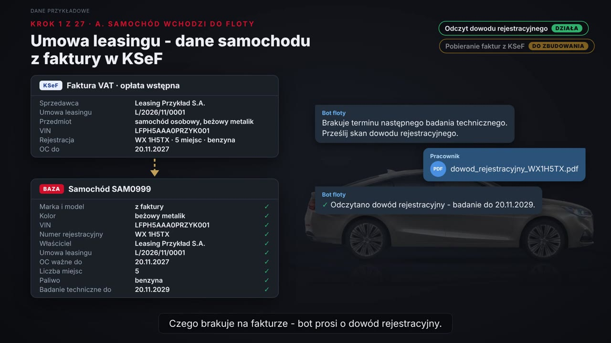
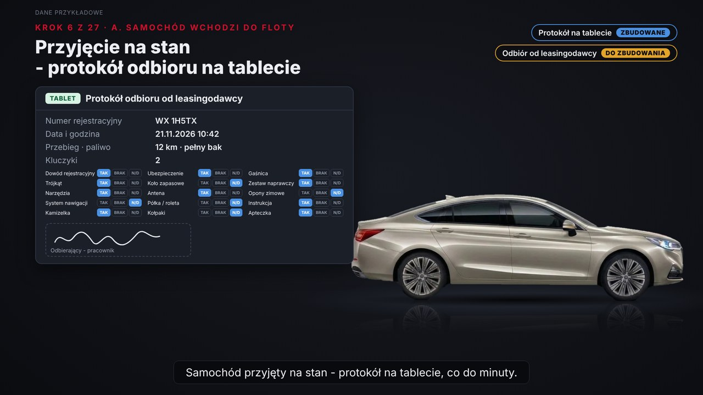

# Boty w akcji

**Onboarding pojazdu i kierowcy u partnera flotowego aplikacji przewozowych i taxi** - od umowy leasingu do pierwszego kursu kierowcy.

▶ **Film (ok. 4,5 min):** https://onboarding.trynity.eu/ - pod filmem lista wszystkich kroków; kliknięcie kroku przenosi do tego miejsca w filmie.

## O projekcie

Partner flotowy udostępnia samochody i kierowców aplikacjom przewozowym i firmom taxi. Każdy nowy samochód i każdy nowy kierowca to dziesiątki czynności: faktury, dokumenty, terminy, protokoły, urządzenia, zgłoszenia w urzędach i aplikacjach. Ten projekt zamienia je w jeden proces prowadzony przez boty:

- pracownik rozmawia z botami w komunikatorze - bot podpowiada kolejny krok i pilnuje braków,
- dokumenty czyta sztuczna inteligencja, a pracownik tylko zatwierdza odczyt,
- kierowca podpisuje dokumenty i protokoły na tablecie, bez drukowania,
- wszystko trafia do jednej bazy z pełną historią zmian - kto, co i kiedy,
- terminy (OC, badania, przeglądy, uprawnienia) pilnuje bot i przypomina z wyprzedzeniem.

## Proces - 4 etapy

| Etap | Co się dzieje |
|---|---|
| **A. Samochód wchodzi do floty** | dane samochodu z faktury w KSeF, zgłoszenie VAT-26, ewidencja przebiegu z GPS, plan przeglądów zgodny z warunkami gwarancji producenta, roczny limit km, protokół odbioru na tablecie |
| **B. Przystosowanie do taxi** | GPS, taksometr, instalacja LPG, wpis TAXI w dowodzie, polisa OC, licencja i oklejenie, kategorie pojazdu i listy pojazdów w aplikacjach przewozowych |
| **C. Kierowca** | rejestracja z odczytem dokumentów, weryfikacja (dokumenty, tożsamość, kod SMS i e-mail, uprawnienia), kaucja, wniosek o identyfikator, kasa fiskalna i terminal |
| **D. Wydanie i opieka w czasie pracy** | protokół wydania na tablecie (wyposażenie, poprzednie i nowe uszkodzenia, uwagi głosowe), przeglądy umawiane automatycznie, ochrona przed przekroczeniem przebiegu, kontrola uprawnień, kontakt z kierowcą przez SMS i e-mail, mandaty - wskazanie kierującego |

| | | |
|---|---|---|
|  |  |  |
| Faktura z KSeF → dane samochodu w bazie | Protokół odbioru na tablecie | Wydanie samochodu kierowcy |

## Połączenia z innymi systemami

Dane pobierane są u źródła - ręcznie wprowadza się tylko to, czego nie da się pobrać.

| System | Do czego | Stan |
|---|---|---|
| **Gmail** | skany dokumentów przysłane e-mailem trafiają do odczytu; e-maile do kierowców (kody weryfikacyjne, powiadomienia); odbiór e-maili od kierowców przez bota | skany i wysyłka - działa; odbiór - zaplanowane |
| **SMSAPI** | SMS-y do kierowców (kody weryfikacyjne, przypomnienia); odbiór SMS-ów od kierowców przez bota | wysyłka - działa; odbiór - zaplanowane |
| **Webfleet** (operator GPS) | przebieg i ewidencja przebiegu, nowe samochody z GPS, przypisanie kierowcy do samochodu przy wydaniu, prognoza rocznego limitu km | zaplanowane |
| **CEPiK** (API) | dane pojazdów i badań technicznych, uprawnienia kierowców sprawdzane co 24 godziny | zaplanowane |
| **GUS** - API REGON (BIR) | dane działalności kierowcy: REGON, PKD przewozu taxi | działa |
| **Biała lista VAT** | weryfikacja NIP kierowcy prowadzącego działalność | działa |
| **TERYT** (GUS) | adres w jednym formacie, gmina, powiat, właściwy urząd skarbowy | działa |
| **KSeF** | faktury zakupowe: leasing, montaże (GPS, taksometr, LPG), serwis - dane trafiają do samochodu | zaplanowane |
| **e-Doręczenia** | pisma z urzędów: licencje, wezwania do wskazania kierującego (mandaty) i odpowiedzi | zaplanowane |
| **Uber** - strona www | wymagania i lista modeli pojazdów dopuszczonych w mieście, z kategoriami - pobierane co miesiąc | działa |
| **Uber** - raporty z portalu floty | dane o kierowcach i przejazdach z raportów (Uber nie udostępnia API) | zaplanowane |
| **Bolt, FreeNow** - strony www | wymagania i listy modeli pojazdów w kategoriach - pobierane co miesiąc | działa |
| **Firmy taxi** - strony www | wymagania dla pojazdów i kierowców | działa |
| **Bolt, FreeNow, firmy taxi** - API flot | dodawanie kierowców i samochodów do flot, zaproszenia dla kierowców | zaplanowane |
| **Operator kart płatniczych** | transakcje z terminali płatniczych przypisane do kierowców | zaplanowane |
| **Telegram** | boty dla pracowników | działa |
| **Claude API** (Anthropic) | odczyt dokumentów przez AI | działa |

## Technologia

Python · boty Telegram · SQLite z historią zmian · odczyt dokumentów przez AI (Claude) · strona podpisów na tablecie (HTTPS) · raporty w Telegram Mini App · serwer VPS w Polsce. Kod powstaje we współpracy z Claude Code.

## Zasady

- **RODO:** dane osobowe są tylko w systemie, nigdy w repozytorium; w filmie i w tym opisie - dane przykładowe.
- **Historia:** każda zmiana danych jest zapisana - kto, co i kiedy.
- **Prawo i podatki:** wątpliwości są zbierane i konsultowane z prawnikiem i doradcą podatkowym, zanim trafią do procesu.

To repozytorium zawiera opis projektu. Kod źródłowy jest prywatny.

## Autor

**Trynity Sp. z o.o.** - wdrożenia enova365 i integracje AI
Mariusz Gajda

---
Muzyka w filmie: „Keep the Funk ON” - mixkit.co (licencja Mixkit) · „Funkorama” - Kevin MacLeod (incompetech.com), licencja Creative Commons: Uznanie autorstwa 4.0 (creativecommons.org/licenses/by/4.0).
